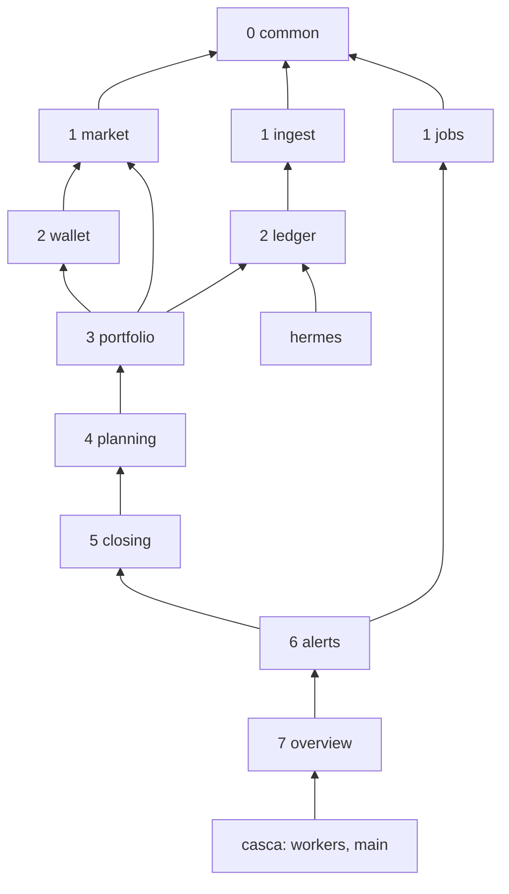
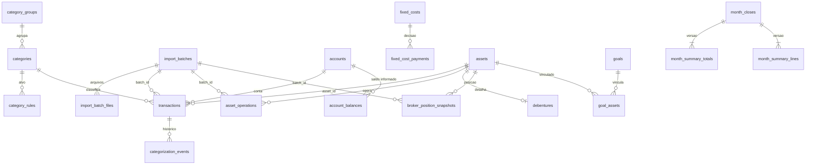
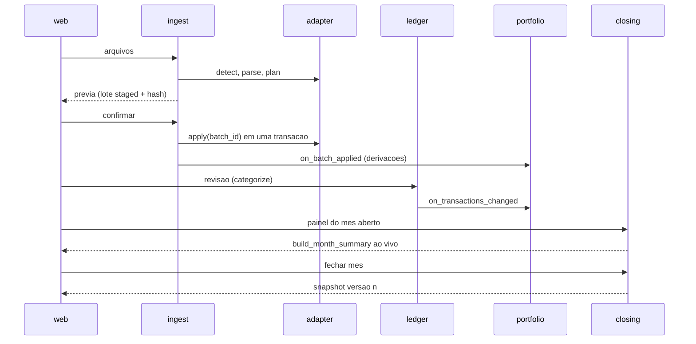

# Architecture Spine — Goodies v2.0

## Design Paradigm

**Monólito modular em camadas.** Um processo FastAPI. Cada *engine* em `api/engines/<engine>/` é um
módulo com fronteira própria e só importa engines de camada menor (AD-1).

**Núcleo funcional / casca imperativa.** Toda regra de dinheiro é função pura em `calc.py`
(Decimal, sem IO). `service.py` carrega, chama o núcleo e grava (AD-2).

**Fatos e decisões persistidos, leituras derivadas.** O banco guarda:
- fatos importados (transações, operações, posições, saldos informados, preços, índices);
- decisões humanas (categoria, regra, confirmação de casamento, aporte planejado, metas,
  objetivos, fechamento de mês, dispensa de aviso).

Orçamento, consumido, distribuição, alocação, avisos e conciliação são derivados na leitura. Só o
fechamento de mês congela leituras (AD-8).

| Camada | Engine | Responsabilidade |
| --- | --- | --- |
| 0 | `common` | `Money`, `Valued`, datas/período, db/deps, cache, owner, `Alert`/`AlertContext`, `MonthStatusPort`, enums compartilhados |
| 1 | `market` | preços (`upsert_price`), histórico de preço, câmbio, índices (CDI, IPCA) |
| 1 | `ingest` | lotes e arquivos de import, cobertura por fonte, protocolo `SourceAdapter` |
| 1 | `jobs` | registro de execuções (`job_runs`) |
| 2 | `ledger` | contas, saldos, transações, categorias, regras, pagador, custos fixos, adapter Nubank |
| 2 | `wallet` | scan de carteiras cripto e DeFi (fetchers dedicados, ADR-005/013) |
| 3 | `portfolio` | ativos, operações, posições, XIRR, RF/debêntures, caixa em corretora e a caminho, conciliação, adapters B3 |
| 4 | `planning` | objetivos, metas/bandas/pisos, alocação, aporte planejado, distribuição, orçamento do mês |
| 5 | `closing` | resumo do mês, fechar/reabrir, versões, **toda leitura por período** |
| 6 | `alerts` | central de avisos |
| 7 | `overview` | painel principal |

Casca acima das engines (nenhuma engine a importa): `api/workers/` (scheduler, catch-up, rota de
jobs) e `api/main.py` (wiring dos registros). `api/auth/` fica abaixo de `common` (`common.deps` o
importa; `auth` não importa `common`). `api/hermes/` é cliente de `ledger.service`.

## Invariants & Rules



Setas indicam "pode importar"; transitividade vale (camada 3 pode importar 0–2).

### AD-1 — Direção de dependência entre engines

- **Binds:** all
- **Prevents:** os ciclos atuais (market↔portfolio, portfolio↔wallet, wallet→ledger) e novos ciclos.
- **Rule:** engine só importa engine de camada **menor**; mesma camada não se importa. Engine baixa que
  precisa de algo de cima recebe por **registro** feito em `main.py` (AD-5, AD-6, AD-10). Atribuição explícita de
  um movimento a uma story vence a regra "primeira story que tocar".
  Movimentos obrigatórios, feitos pela primeira story que tocar o módulo:

  | De | Para |
  | --- | --- |
  | `portfolio/constants.py` (enums) | `common` |
  | `ledger` `Alert` | `common` |
  | `portfolio.service.upsert_price`, `clear_manual_price` | `market.service` (ADR-012: precedência `is_manual` e invalidação de cache preservadas) |
  | `market/cache.py` `PriceCache` | `common.cache` (instância única) |
  | conciliação wallet × `net_quantity` | `portfolio` |
  | SQL de `benchmark_workers.py` | `market.service` |
  | `engines/jobs/router.py` | `api/workers/` |
  | `engines/analytics/` (vazio) | apagado |

### AD-2 — Layout de módulo por engine

- **Binds:** all (backend)
- **Prevents:** três layouts convivendo e SQL espalhado por routers.
- **Rule:** cada engine tem `router.py` (só HTTP), `service.py` (orquestração e `conn.transaction()`),
  `queries.py` (todo o SQL, `$n` params), `models.py` (Pydantic de I/O) e `calc.py` (puro, sem IO).
  - Cálculo grande pode ter módulo puro irmão (`xirr.py`, `distribution.py`) com as mesmas regras
    de `calc.py`.
  - Código novo nasce assim; módulo legado migra quando uma story o toca, na mesma story.
  - `Db`, `AuthUser` vêm de `common.deps`.

### AD-3 — Dono único por tabela

- **Binds:** all
- **Prevents:** duas engines gravando a mesma entidade por caminhos diferentes.
- **Rule:** só a engine dona escreve na tabela (mapa no Structural Seed). Leitura cruzada passa por
  funções públicas de `service.py`/`queries.py` da dona; nunca SQL próprio sobre tabela alheia.
  `hermes` grava via `ledger.service`; workers chamam services.

### AD-4 — Dinheiro e números

- **Binds:** all
- **Prevents:** float em conta de dinheiro, arredondamento divergente, somas que não fecham, conta
  feita no navegador.
- **Rule:**
  - Dinheiro é `Decimal` em todo o Python; proibido `float()` em dinheiro.
  - Fronteira HTTP: `common.money.Money` (`Annotated[Decimal, ...]`) serializa como JSON number
    com 2 casas, `ROUND_HALF_EVEN`. Percentual: `common.money.Pct`, number com 2 casas, já em %.
    Quantidade: string decimal.
  - O frontend **nunca** faz aritmética de dinheiro: totais, subtotais, diferenças e recálculos
    interativos vêm da API (AD-15, endpoints de prévia). `web/lib/format` só formata.
  - Rateios (distribuição, objetivos) fecham ao centavo pelo método do maior resto.
  - Quantização a centavos acontece no `calc` que produz o termo; gravado como `numeric(15,2)`.
    Taxas internas são frações (0,0548); só `Pct` na fronteira vira %.

### AD-5 — Ingestão: lote, adapter e proveniência

- **Binds:** FR-1–FR-7, FR-5, NFR-proveniência, NFR-correção
- **Prevents:** importadores com fluxos diferentes, import sem transação, desfazer impossível,
  duplicação B3 entre movimentação e negociação.
- **Rule:** `ingest` define `SourceAdapter`; adapters vivem na engine dona e se registram em `main.py`:

  ```text
  detect(file) -> Source | None
  parse(file) -> ParsedFile
  plan(conn, parsed) -> ImportPlan          # novos, existentes, pulados, período, conta, saldo informado
  apply(conn, plan, batch_id) -> Applied    # grava os fatos da própria engine
  undo(conn, batch_id) -> None
  ```

  - **Prévia → confirmação:** a prévia cria `import_batches` `staged` com o plano e um hash; nada
    de fato é gravado. Confirmar re-planeja, exige o mesmo hash e roda todos os `apply` numa
    **única** transação; o lote vira `applied`. `staged` expira em 24 h.
  - Cada arquivo vira uma linha de `import_batch_files` (fonte, conta/corretora, `period_start`,
    `period_end`, hash do arquivo, saldo informado). Mesmo hash já aplicado → "arquivo já importado".
  - Toda linha importada carrega `batch_id` e `source`. Dedup pelo `external_id` da fonte (FITID;
    `operation_hash`). B3: o `plan` mantém a regra de cobertura por ticker
    (`_ticker_cutoffs`) e reporta os pulados.
  - Após `apply`, `ingest` dispara os hooks `on_batch_applied` registrados (AD-6), na mesma transação.
    Dentro do `apply`, a derivação roda só por esse hook; o `categorize()` chamado pelo adapter não
    dispara `on_transactions_changed`.
  - `account_balances` (saldo informado do OFX) também carrega `batch_id`.
  - Desfazer (FR-6): último lote `applied`, até 7 dias, numa transação. Ordem: `ingest` chama os
    hooks `on_batch_undo(conn, batch_id)` em ordem de camada decrescente (`portfolio` remove as
    operações derivadas das transações do lote), depois o `undo` de cada adapter.
    `asset_operations.transaction_id` é FK `ON DELETE RESTRICT`.
    - Saem também as `categorization_events` dessas transações (única exceção ao append-only,
      FK `ON DELETE CASCADE`) e as regras com `created_in_batch`.
    - Transações de fora do lote categorizadas por uma regra removida voltam por `categorize()`
      sem ela (`suggestion`, `pending`); `category_rule_id` é `ON DELETE SET NULL`.
    - O lote vira `undone`. Lote `legacy` não se desfaz.
  - "Atualizado até" e lacunas (FR-3, FR-4) derivam só de `import_batch_files` dos lotes `applied`
    e `legacy`. Lacuna por intervalo só no Nubank; consolidado B3 = mês sem arquivo; B3 movimentação/
    negociação só pelo aviso de transferência não coberta; lote `legacy` sem lacuna interna.
  - Escolha feita na prévia (conta do CSV, período B3) gera nova prévia com `overrides`: novo `staged` e
    hash que cobre os overrides.
  - Toda escrita de lote invalida o cache de XIRR (`common.cache`).

### AD-6 — Categorização e derivações do caixa

- **Binds:** FR-8–FR-12, FR-15, FR-16, FR-19, FR-23, FR-24, SM-5, SM-6, SM-C1
- **Prevents:** `kind` divergindo do grupo; linhas sem categoria lidas de dois jeitos; termos que
  quebram quando um grupo é renomeado; operações de caixinha desatualizadas depois de uma correção;
  curadoria manual sobrescrita.
- **Rule:**
  - Toda inserção e mudança de categoria passa por `ledger.service.categorize()`. Não existe
    transação sem categoria: o adapter usa as subcategorias de sistema **Entrada a classificar** /
    **Saída a classificar** até a revisão.
  - `category_groups.kind` define o tipo; a subcategoria herda. `transactions.kind` é cópia gravada
    só por `categorize()` e regravada quando a subcategoria muda de grupo. O tipo de um grupo com
    transações não muda; mudar = mover as subcategorias.
  - "Entrada a classificar" e "Saída a classificar" ficam num grupo de sistema por tipo (pelo
    sinal). Entram em receita total e gastos, nunca em trabalho, resgates, devoluções, dívidas ou
    custo fixo. O fechamento bloqueia enquanto existirem.
  - `categories.role` (CHECK): `work_income`, `resgate`, `devolucao`, `divida`, `consumo`,
    `investimento`, `transferencia`, `a_classificar`. Termos de dinheiro (AD-7) leem **role**, nunca
    nome. Subcategoria nova herda o role padrão do grupo (`consumo` em gasto, `work_income` em
    receita, `investimento`, `transferencia`); o Vitor pode trocar.
  - `categories.key` é imutável e única (ex.: `invest:toro_b3`, `invest:cripto_nubank`). Código que precisa de
    uma categoria específica (trilhos de `transit`, `CaixinhaSpec`, bloco cripto) lê `key`; nunca nome. Renomear
    muda só o rótulo.
  - Cada subcategoria de investimento tem o par de resgate registrado (`invest:x` ↔ `resgate:x`); quem
    precisa do líquido de um trilho (`transit`, bloco cripto, caixinhas) lê as duas keys.
  - `category_rules` têm `direction ∈ {entrada, saida, ambos}`; a detecção de transferência interna fica no
    adapter Nubank, antes das regras.
  - `transactions.category_source ∈ {rule, suggestion, manual}`; `manual` nunca é sobrescrito.
    `review_status ∈ {pending, confirmed}`. Toda mudança gera linha em `categorization_events`
    (append-only: antes, depois, origem, `cause`, lote) — base de SM-5, SM-6 e SM-C1.
  - Regras em `category_rules` ("descrição contém", `created_in_batch`). Vence a condição mais
    longa; empate → a mais recente. `transactions.category_rule_id` guarda a regra aplicada.
  - Pagador (`transactions.payer`) é campo extraído pelo adapter; nunca entra em regra.
  - **Ativo da transação:** `transactions.asset_id` é preenchido por um resolver que `portfolio`
    registra em `ledger` (ex.: "Caixinha SnowTrip" → ativo `caixinha:snowtrip`).
  - **Derivação:** `portfolio` registra `on_transactions_changed(conn, tx_ids)` em `ledger` e
    `on_batch_applied`/`on_batch_undo` em `ingest`. `ledger` chama o primeiro depois de
    `categorize()` e de reaplicação fora de lote. A derivação (operações de caixinha/RF, aporte de
    debênture sugerido com `status ∈ {suggested, confirmed, dismissed}`) é idempotente por
    `transaction_id` e roda na mesma transação.
  - Pendentes contam nas leituras com a categoria proposta e entram em "transações a revisar".

### AD-7 — Termos de dinheiro: uma função por termo

- **Binds:** FR-5, FR-13, FR-15–FR-20, FR-25, FR-28–FR-32, FR-34
- **Prevents:** painel, orçamento, histórico e fechamento calculando o mesmo termo de jeitos
  diferentes; uma transação descontada duas vezes.
- **Rule:** cada termo é **uma** função pura; toda leitura que o mostra a chama.

  | Termo | Mora em | Definição |
  | --- | --- | --- |
  | saldo calculado | `ledger/calc` | `opening_balance` da conta + Σ transações até a data |
  | conferência de saldo (PF) | `ledger/calc` | encadeada: saldo informado anterior + Σ transações do intervalo = saldo informado atual; mês conferido = primeiro saldo informado ≥ fim do mês com todos os intervalos batendo |
  | receita do trabalho, resgates, devoluções | `ledger/calc` | por `role` |
  | gastos | `ledger/calc` | Σ `kind = expense`, brutos por categoria |
  | consumido | `ledger/calc` | gastos − deduções; cada transação cai em **um** balde: custo fixo casado > dívida > devolução |
  | taxa de poupança | `ledger/calc` | (trabalho − (gastos − devoluções)) / trabalho |
  | resultado do mês | `ledger/calc` | receitas − gastos − investimento |
  | casamento de custo fixo | `ledger/calc` | guloso global 1:1: decisões de `fixed_cost_payments` primeiro; depois pares (±10%, −5/+5 dias) por (\|Δvalor\|, \|Δdata\|, `fixed_cost_id`, `transaction_id`); cada lado casa uma vez |
  | a caminho, caixa em corretora | `portfolio/calc` | resíduo por corretora × cobertura de `ingest` (FR-25) |
  | valor investido | `portfolio/calc` | posições + bloco cripto + caixa em corretora (base do XIRR) |
  | patrimônio | `portfolio/calc` | valor investido + saldo das contas |
  | disponível para consumo | `planning/calc` | trabalho + resgates − custos fixos (pago: valor pago; pendente: valor cadastrado) − aporte planejado − dívidas do mês (sem valor informado: Σ role `divida` não casada) |
  | restante | `planning/calc` | disponível − consumido |
  | restante sem os resgates | `planning/calc` | restante − resgates |
  | consumo financiado por resgate | `planning/calc` | mín(resgates, máx(0, consumido − disponível sem resgates)), separado em por objetivo × por carteira |
  | realizado / pendente | `planning/calc` | realizado total inclui a caminho; por classe só quando vira ativo; pendente = planejado − realizado total |

  - Bloco cripto: nunca custo nem rentabilidade por ativo (só valor atual).
  - Rendimentos de FII, dividendos e juros ficam separados de ganho de capital em `asset_operations`.
  - Rentabilidade é só XIRR (ADR-002/008), em `portfolio/xirr.py`.

### AD-8 — Resumo do mês e leitura por período

- **Binds:** FR-7, FR-22, FR-32–FR-34, SM-2, SM-3
- **Prevents:** ao vivo × congelado divergindo; mês fechado com números diferentes em Caixa e Visão
  geral; trimestres mistos agregados de jeitos diferentes; aviso de ajuste disparando em todo mês.
- **Rule:**
  - `closing.build_month_summary(conn, month, as_of)` é a única forma de calcular o resumo, com as
    funções de AD-7. `as_of` = fim do mês (ou hoje, no mês corrente). Preço vem de
    `market.asset_price_history` até `as_of`; B3 de meses passados, do consolidado
    (`broker_position_snapshots`); RF, do CDI até `as_of`.
  - **Termos de AD-7, resumos e posição/rentabilidade por período são servidos por `closing`** (ou
    `overview`, que o chama). `planning` e `portfolio` expõem construtores por mês.
    - Listas de fatos filtradas por mês (transações, operações) ficam na dona, com `month` ou
      intervalo, nunca `leitura`.
    - Escritas e prévias do mês (aporte planejado, travas, dívidas) ficam em `planning`, com `month`.
  - Mês aberto: ao vivo. Mês fechado: snapshot da versão vigente, nunca recalculado.
  - Período (`closing.build_period_summary`):
    - `tri` = meses do trimestre civil que contém `periodo`, até `periodo`; `ano` = jan..`periodo`;
      `inicio` = jul/2024..`periodo`. Nunca entra mês posterior.
    - Totais somam os meses (fechados do snapshot, aberto ao vivo); a resposta traz
      `source ∈ {snapshot, live}` por mês, `as_of` = o mais antigo, `stale` = OU dos meses.
    - Razões são recalculadas dos componentes somados, nunca média de razões.
    - XIRR do período usa o **valor investido** (sem saldo das contas) no início e no fim, mais os
      fluxos líquidos de investimento datados. Valor inicial = mês anterior (snapshot se fechado;
      senão `build_month_summary(anterior, as_of = fim do mês)`); sem nenhum → `Valued` null
      `antes_do_primeiro_fechamento`.
  - Fechar grava `month_closes` (mês, versão, status, `closed_at`, cobertura por fonte, confirmações
    "fechar mesmo assim", `origin ∈ {live, retro}`), `month_summary_totals` (**todos** os termos de
    AD-7, mais valor investido, aplicado, resultado e saldo conferido) e `month_summary_lines`
    (`month, version, metric, dimension_kind, dimension_id, flow_date, value`) com as quebras e os
    fluxos líquidos por classe e data.
    - `dimension_id` é `text` com tipo fixo por `dimension_kind`: `category` → `categories.id`,
      `class` → enum de classe, `asset` → `assets.id`, `goal` → `goals.id`, `account` →
      `accounts.id`.
    - Tela de mês fechado só mostra campos do snapshot. Campo novo = coluna nova + refechar.
  - Precondições: registro em `closing`, em que cada engine registra verificações `bloqueia` ou `confirma`. Bloqueia
    com transações pendentes ou saldo divergente da conta PF (sem saldo informado
    no fim do mês = pendência com "fechar mesmo assim"); posição divergente e a
    caminho pedem "fechar mesmo assim", que fica gravado.
  - Reabrir muda o status; fechar de novo cria `version + 1`. Versões antigas nunca são apagadas nem
    exibidas.
  - **Ajuste em mês fechado:** escritas que tocam um mês fechado (`ingest`, `categorize`,
    reaplicação, desfazer) chamam `MonthStatusPort.mark_dirty(month)`; o aviso nasce do `dirty`, que
    zera ao refechar. A prévia de reabrir calcula a diferença só das métricas de fluxo, com o mesmo
    arredondamento. `MonthStatusPort`: `status(month)`, `is_closed(month)`, `mark_dirty(month)`.
  - Num mês fechado, `month_plans` e `fixed_cost_payments` são só leitura até reabrir.
  - **Retroativo (FR-7):** `closing.close_retro(months)` é comando de serviço
    (`python -m scripts.ops.close_retro`), rodado **depois** das revisões de dados de AD-16 (aborta
    se o Alembic não estiver em `head`). Termos ainda sem engine ficam `fora_do_resumo`; quando `planning`
    existir, `planning.ensure_month_plan(month, mode='retro')` dá as dívidas do mês = Σ transações de role
    `divida` não casadas a custo fixo, e aporte planejado e pendente = null (`nao_definido`), via `refechar`. Patrimônio B3 do consolidado (mensal 2026; anual = dezembro); cripto retroativa =
    aplicado do bloco, cobertura "estimada"; mês sem consolidado = "patrimônio não coberto".

### AD-9 — Derivar por padrão, persistir só decisões

- **Binds:** FR-14, FR-18, FR-25, FR-26, FR-29–FR-31
- **Prevents:** tabelas de estado derivado que envelhecem e divergem dos fatos.
- **Rule:** casamentos automáticos (custo fixo, aporte × objetivo, transferência × lote B3) são
  derivados na leitura. Só decisão humana é gravada: `fixed_cost_payments` (confirmação, correção,
  manual), travas da distribuição em `month_plans`, vínculos objetivo × ativo em `goal_assets`.
  Exceções: o snapshot (AD-8) e o `dirty`.

### AD-10 — Central de avisos por providers

- **Binds:** FR-14, SM-C2
- **Prevents:** chave instável de aviso; engines baixas importando `alerts`; contexto montado de
  formas diferentes.
- **Rule:** cada engine registra `alert_provider(conn, ctx: AlertContext) -> list[Alert]` em `main.py`.
  Avisos são compute-on-read.
  - `AlertContext` (congelado, em `common`): hoje BRT, período, status dos meses
    (`MonthStatusPort`), owner.
  - `Alert`: `key = "<tipo>:<sujeito>"`, `fingerprint` (hash da condição), `severity ∈ {divergencia,
    aviso}`, mensagem pt-BR, ação (rota + parâmetros), `as_of`, `dismissible`.
  - Persistir só dispensas: `alert_dismissals(key, fingerprint, dismissed_at)`. Volta quando o
    fingerprint muda; some quando o provider para de emitir.
  - `jobs` emite aviso de worker com falha ou atrasado (substitui o Discord até a v2.1).

### AD-11 — Ativos, objetivos e alocação

- **Binds:** FR-21, FR-23, FR-24, FR-29, FR-35, Q1
- **Prevents:** dinheiro de objetivo inflando a RF; chaves de ativo incompatíveis entre tabelas;
  `portfolio` dependendo de `planning`.
- **Rule:**
  - `assets` (dono `portfolio`): `id` uuid, `key` imutável (`b3:BBAS3`, `td:IPCA+2032`,
    `caixinha:turbo`, `crypto:BTC`), classe (`acoes_br`, `etfs`, `fiis`, `renda_fixa`,
    `aposentadoria`, `cripto`), `price_ref` (ticker em `asset_prices`), valoração, `%CDI`.
    Backfill de `asset_operations`, `portfolio_targets` e `wallet_positions`, com mapa dos rótulos
    legados.
  - Tabelas novas referenciam ativo **só** por `assets.id`. `wallet_positions` ganha `asset_id`,
    resolvido por `asset_aliases(asset_id, chain, symbol)` de `portfolio`.
  - `portfolio_targets` (dono `planning`) tem `class` + `asset_id` nulo (nulo = meta da classe).
  - `goals` e `goal_assets` são de `planning`. O vínculo nasce da caixinha nomeada no OFX, como
    decisão confirmada.
  - Metas, bandas, pisos e o cálculo de alocação são de `planning`; a base da alocação exclui ativos
    em `goal_assets`. `portfolio` só fornece posições.
  - Progresso do objetivo = valor atual dos ativos; "aportado" = aportes líquidos a eles.
  - `debentures` (dono `portfolio`) referencia `assets` e substitui o JSON e o seed.

### AD-12 — Distribuição do aporte [ADOPTED]

- **Binds:** FR-28–FR-31
- **Prevents:** o passo 1 entregando "tudo o que falta"; a ordem dos passos variando.
- **Rule:** `planning/distribution.py: distribute(planned, goals, targets, positions, locks)`, pura,
  em ordem fixa:
  1. **Reserva de emergência**: falta ÷ meses restantes (horizonte editável, padrão 12; alvo =
     multiplicador × custos fixos, padrão 6). Atendida primeiro, até encher.
  2. **Demais objetivos**: falta ÷ meses até o prazo; se faltar aporte, proporcional às necessidades.
  3. **Classes**: déficit monotônico sobre a base de AD-11, piso por classe, acima da banda só o piso;
     pisos reduzidos em proporção se não couberem.
  4. **Ativos**: déficit dentro da classe; cripto pelo valor atual.
  - Travas (FR-30) entram fixas; o resto redistribui pela mesma regra. Nunca sugere venda. Soma fecha
    ao centavo (AD-4).

### AD-13 — Conciliação: tolerâncias num lugar só [ADOPTED]

- **Binds:** FR-5, FR-25, FR-26, SM-2, SM-3
- **Prevents:** cada tela com um limite próprio para "divergente".
- **Rule:** tolerâncias são constantes de `portfolio/calc` e `ledger/calc`; a comparação é por
  **quantidade**, contra fatos gravados (`account_balances`, `broker_position_snapshots`,
  `broker_cash_checks`, `wallet_positions`).

  | Confere | Contra | Tolerância |
  | --- | --- | --- |
  | saldo Nubank PF (CPF) | saldo informado do OFX | R$ 0,00 |
  | saldo Nubank MEI | — | não confere (conta sempre zerada; o dinheiro passa para a PF) |
  | ações, FII, ETF, BDR | consolidado B3 | quantidade exata |
  | Tesouro | consolidado B3 | 0,01 título |
  | caixa em corretora | conferência informada | R$ 1,00 |
  | cripto | scan | sem divergência; aviso se o scan tiver mais de 14 h |
  | caixinhas, debêntures | sem origem | não concilia; "valor calculado" |

### AD-14 — Período e tempo

- **Binds:** all
- **Prevents:** mês representado de jeitos diferentes; "hoje" em UTC num lugar e BRT noutro.
- **Rule:**
  - API: `periodo = "YYYY-MM"`; `leitura ∈ {mes, tri, ano, inicio}`; resolução única em
    `common.dates.resolve_period(periodo, leitura) -> list[month]`.
  - Banco: mês = `date` no dia 1.
  - "Hoje" e limites de mês: `common.dates.today_brt()`.
  - Timestamps técnicos em `timestamptz` UTC.
  - Cadastros que mudam no tempo (`fixed_costs`, metas) têm vigência (`valid_from`, `valid_to`).

### AD-15 — Contrato HTTP

- **Binds:** all (API)
- **Prevents:** `dict[str, Any]`, erros em três formatos, "zero" no lugar de "sem dado", data dos
  dados calculada no navegador.
- **Rule:**
  - Rotas novas `/api/v1/<engine>/<recurso>`; as legadas mudam quando tocadas.
  - Toda rota nova ou tocada declara `response_model`.
  - Erro: `detail={"error": "<codigo_snake>", "message": "<pt-BR>"}`.
  - Lista paginada: `{items, total, limit, offset}`; sem envelope nos demais.
  - Termos de AD-7 e totais de painel/resumo = `Valued[T]` (`common.models`); colunas de listas de
    fatos são `Money` simples: `value` (null quando não há dado),
    `unavailable_reason` (enum: `nao_definido`, `aguardando_ipca`, `antes_do_primeiro_fechamento`,
    `sem_preco`, `sem_metas`, ...), `as_of` (a data mais antiga das fontes, calculada no backend),
    `source`, `stale`. `as_of` substitui o `last_updated` do ADR-004 nas rotas novas.
  - `stale` = falha de API externa (nunca 5xx, ADR-012); defasagem de arquivo é aviso (FR-3), não
    `stale`.
  - Recálculo interativo e efeitos de ações em massa vêm de rotas de prévia que não gravam
    (`POST .../preview`: distribuição, orçamento, desfazer, reaplicar regras, proposta de regra).

### AD-16 — Migrações de esquema e de dados

- **Binds:** FR-7, FR-8, FR-19, NFR-correção
- **Prevents:** correções de dado espalhadas, aplicadas duas vezes ou fora de ordem.
- **Rule:**
  - Mudança de modelo e backfill na **mesma** revisão Alembic, SQL idempotente. Ordem:
    1. `user_id` no ledger;
    2. `import_batches`/`import_batch_files` + lotes `legacy` por fonte e conta (com `batch_id` e
       `source` nas linhas antigas);
    3. grupos, roles, `category_id`, `category_rules` (legado), `category_source` (padrão atual
       bate → `rule`; senão `manual`);
    4. reclassificações: resgates (FR-19), faturas em Dívidas → Cartão de crédito, Repasse →
       Devoluções;
    5. `assets` e chaves.
  - Depois das revisões, roda `close_retro` (AD-8). Resumo nunca é calculado em SQL de migração.
  - Cada revisão de dado tem teste de invariantes: gate jun/2026 = 55,48%; contagem de transações
    inalterada; zero órfãs; deltas esperados de cada reclassificação listados no teste.
  - `scripts/oneoff` fica para operação pontual, nunca para mudar o modelo.
  - Nome `NNNN_snake_name.py`, revision = nome do arquivo.

### AD-17 — Frontend: 4 áreas por estrangulamento

- **Binds:** FR-36, DESIGN.md, EXPERIENCE.md
- **Prevents:** reescrita big-bang, primitivos de duas bibliotecas, cache do navegador desatualizado.
- **Rule:**
  - Rotas novas `web/app/(app)/{visao-geral,caixa,investimentos,ajustes}/<aba>`; período e leitura
    na URL (`?periodo=2026-10&leitura=tri`). Desde o marco 1, a navegação mostra só as 4 áreas e
    Importar; rotas antigas ficam por URL e são apagadas no marco 4.
  - shadcn/ui inicializado com `shadcn init -b radix`, estilo new-york; `components.json`
    commitado; proibido `init -d` (default atual é Base UI). Primitivos em `web/components/ui/`,
    substituindo `ui.tsx`; domínio em `web/components/<area>/`.
  - Hooks TanStack Query em `web/lib/<engine>.ts`; queryKey = `[engine, recurso, periodo?, ...]`.
    Toda mutação invalida a própria engine e `planning`, `portfolio`, `closing`, `alerts`,
    `overview`; import e desfazer invalidam todas. A key legada `"wallets"` continua.
  - Tabelas com `@tanstack/react-table` v9.
  - Páginas são client components; tipos em `web/types/<engine>.ts` espelham `models.py`.
  - Tema: tokens do DESIGN.md em `app/globals.css` (`@theme inline`), `color-scheme` por modo;
    `next-themes` com `defaultTheme="system"` + switch. Nunca hex em componente.
  - Auth (ADR-006): access token em memória; 401 → refresh pelo cookie → repete a chamada; falhou
    → `/login?next=<rota+query>`.

### AD-18 — Ambiente e operação: Railway em produção, compose em dev

> Na v2.0 a regra era "só localhost" (ADR-014). Desde 2026-11-10 vale o ADR-018 (v2.1 no Railway).

- **Binds:** NFR-privacidade, NFR-resiliência, ADR-003, ADR-006, ADR-018
- **Prevents:** banco exposto na internet; perda do único banco; worker falhando em silêncio; sessão quebrada entre
  domínios.
- **Rule:**
  - Produção no Railway: Postgres 15 (`postgres-ssl:15`), Redis 7, `api` e `web`. Só o `web` tem domínio público;
    ele repassa `/api/v1/*` para a api pela rede privada (`API_INTERNAL_URL`). Api, Postgres e Redis sem domínio
    nem TCP proxy público (o TCP proxy só liga durante uma carga/cópia de banco).
  - Dev: `docker compose` (postgres 15, redis 7, api) + `pnpm dev`, portas só em `127.0.0.1`.
  - Api com 1 réplica, sem dormir; APScheduler no processo; catch-up ao abrir o app; Binance só via cron.
  - Produção migra na subida (`AUTO_MIGRATE=true`): backup na hora → `alembic upgrade head`; banco vazio faz o
    bootstrap `0001_initial_users` → admin (`ADMIN_EMAIL`/`ADMIN_PASSWORD`, só na 1ª subida) → `head`. Em dev o
    banco real local segue só por `scripts.ops.migrar`, e o desenvolvimento usa `goodies_dev`.
  - **Backup:** job diário `db_backup` + antes de toda escrita de dado; `pg_dump` 15 em `BACKUP_DIR` (produção: volume
    `/backups`); retenção 30 diários + 12 mensais, separada dos pré-migração; `restore_check` mensal; cópia fora do
    Railway por `scripts/backup_railway.sh`; runbooks em `docs/DEPLOY_RAILWAY.md` e `docs/LOCAL_DEV.md`.
  - Cookie de refresh `httpOnly`, `samesite=lax`, `secure` com `ENVIRONMENT=production`, sempre na origem do web.
    `/docs` e `/openapi.json` desligados em produção.
  - Postgres e Redis com senha; a api recusa subir com segredo `dev-insecure-*`/placeholder fora de teste; login com
    limite de tentativas; Hermes desligado (`HERMES_ENABLED=false`).
  - Segredos: produção só nas variáveis do Railway (gerados novos); dev em `.env` (gitignored) sincronizado com
    `.env.example`; gitleaks no pre-commit; `git push` (= deploy) é manual.
  - Owner único: `common.owner.get_owner_id(conn)`; tabelas novas com `user_id` NOT NULL.

### AD-19 — Qualidade e testes

- **Binds:** all
- **Prevents:** regra de dinheiro sem teste; gate de qualidade dependente de CI que não existe.
- **Rule:**
  - TDD por story; `/test` e `/gate` rodam local (não há CI).
  - Todo `calc.py`/módulo puro tem testes unitários. Golden tests mínimos:
    - poupança jun/2026 = 55,48%;
    - números dos mockups (consumido R$ 6.912,37; disponível R$ 8.405,59; financiado R$ 2.994,77;
      aportes 2.200 = 1.700 + 500);
    - distribuição fecha ao centavo;
    - snapshot = ao vivo no instante do fechamento.
  - Serviços contra Postgres real (`goodies_test`).
  - `mypy --strict` nos pacotes inteiros tocados; cobertura ≥ 80%.
  - Web: Vitest só em utilitários puros (`format`, período).
  - `/code-review` ao fim de cada story.

## Consistency Conventions

| Concern | Convention |
| --- | --- |
| Tabelas e colunas | snake_case inglês, tabelas no plural |
| Termos na UI | os do glossário do PRD e do EXPERIENCE, nunca sinônimos |
| Modelos Pydantic | `XCreate`, `XUpdate`, `XResponse`, `XList`, `XPreview` |
| Funções de cálculo | termo do glossário em inglês snake (`consumed`, `available_for_spending`, `distribute`) |
| Ids | `uuid` `gen_random_uuid()`, string no JSON |
| Enums persistidos | `text` + `CHECK`, snake sem acento; os valores listados nos ADs (roles, classes, severidade, `unavailable_reason`, status) são os canônicos, mesmo os em português |
| Logs | `structlog` em tudo (o scheduler sai do `logging`); evento snake + campos; nunca segredo nem valor financeiro |
| Cache | `common.cache` único; chaves `<engine>:<tipo>:<id>`; TTLs em `config.py` (ADR-012) |
| Commits | `tipo(escopo): descrição` com o id da story; migração no mesmo commit do código |
| Docs vivos | a 1ª story atualiza `conventions.md` (sem `queries.py` fantasma nem Server Components por padrão; fontes do DESIGN.md; erro em dict) e reescreve o CLAUDE.md (stack local do compose, sem Supabase/Upstash/Fly/Vercel, gates v2, ADR-014/015) e o `.env.example` |
| Limites | defasagem de fonte (FR-3), janela do desfazer, horizonte da reserva: constantes em `calc.py` da dona |

## Stack

| Name | Version |
| --- | --- |
| Python | 3.12 |
| FastAPI | 0.136.3 |
| asyncpg | 0.31.0 |
| Alembic | 1.18.4 |
| APScheduler | 3.11.2 |
| redis-py | 8.0.0 |
| Pydantic | 2.13.4 |
| SciPy | 1.17.1 |
| structlog | 25.5.0 |
| uv | 0.11.12 |
| PostgreSQL | 15 |
| Redis | 7 |
| Node.js | 24 |
| pnpm | 11 (campo `packageManager`) |
| Next.js | 16.3.8 (+ `eslint-config-next` 16.3.8) |
| React | 19.2.9 |
| TypeScript | 5.9.3 |
| @tanstack/react-query | 5.100.14 |
| @tanstack/react-table | 9.2.4 |
| Tailwind CSS | 4.3.0 |
| shadcn (CLI) | 4.x, `-b radix`, new-york |
| radix-ui | 1.x (resolvido pelo lock) |
| lucide-react | 1.x (resolvido pelo lock) |
| Recharts | 3.8.1 |
| next-themes | 0.4.6 |

## Structural Seed



| Dona | Tabelas |
| --- | --- |
| `ingest` | `import_batches`, `import_batch_files` |
| `jobs` | `job_runs` |
| `market` | `asset_prices`, `asset_price_history`, `benchmark_data` |
| `ledger` | `accounts`, `account_balances`, `transactions`, `category_groups`, `categories`, `category_rules`, `categorization_events`, `fixed_costs`, `fixed_cost_payments` |
| `wallet` | `wallet_positions`, `wallet_position_history`, `defi_positions`, `crypto_cost_basis` |
| `portfolio` | `assets`, `asset_aliases`, `asset_operations`, `debentures`, `debenture_contributions`, `broker_position_snapshots`, `broker_cash_checks` |
| `planning` | `goals`, `goal_assets`, `portfolio_targets` (metas, banda, piso), `month_plans` (aporte planejado, dívidas, travas) |
| `closing` | `month_closes`, `month_summary_totals`, `month_summary_lines` |
| `alerts` | `alert_dismissals` |



```text
api/
  engines/
    common/   market/   ingest/   jobs/
    ledger/   wallet/   portfolio/   planning/   closing/   alerts/   overview/
      router.py  service.py  queries.py  models.py  calc.py
  workers/        # scheduler, JobSpec, catch-up, rota de jobs
  scripts/ops/    # close_retro, backup/restore
  db/migrations/versions/NNNN_*.py
web/
  app/(app)/{visao-geral,caixa,investimentos,ajustes}/
  components/ui/       # shadcn (radix, new-york)
  components/<area>/
  lib/<engine>.ts   lib/format.ts   types/<engine>.ts
```

## Capability → Architecture Map

| Capability / Area | Lives in | Governed by |
| --- | --- | --- |
| FR-1–FR-4, FR-6 hub, cobertura, lacunas, desfazer | `ingest` + adapters | AD-5, AD-15 |
| FR-5 conferência de saldo | adapter Nubank, `ledger` | AD-5, AD-7, AD-13 |
| FR-7 recuperar a base e fechamento retroativo | `ingest`, `closing` | AD-5, AD-8, AD-16 |
| FR-8–FR-12 categorias, revisão, regras | `ledger` | AD-6, AD-16 |
| FR-13 painel | `overview` | AD-7, AD-8, AD-15 |
| FR-14 avisos | `alerts` + providers | AD-10 |
| FR-15, FR-16, FR-20 receitas, gastos, poupança | cálculo `ledger/calc`; rota por período `closing` | AD-6, AD-7, AD-8 |
| FR-17 orçamento | `planning` (cálculo) / `closing` (rota) | AD-7, AD-8 |
| FR-18 custos fixos | `ledger` | AD-7, AD-9 |
| FR-19 resgates como receita | migração | AD-16, ADR-015 |
| FR-21–FR-27 posições, XIRR, RF, debêntures, corretora, conciliação, preços | fatos e cálculo `portfolio`, `market`, `wallet`; posição e XIRR por período `closing` | AD-6, AD-7, AD-8, AD-11, AD-13 |
| FR-28–FR-31 aportes | cadastro, distribuição e prévias `planning`; planejado × realizado por período `closing` | AD-8, AD-9, AD-11, AD-12 |
| FR-32–FR-34 fechamento e comparação | `closing` | AD-8 |
| FR-35 ajustes | dona de cada cadastro | AD-3, AD-14 |
| FR-36 4 áreas | `web/app/(app)/*` | AD-17 |
| SM-2, SM-3 | `closing`, `ledger`, `portfolio` | AD-8, AD-13 |
| SM-5, SM-6, SM-C1, SM-C2 | `ledger`, `alerts` | AD-6, AD-10 |

## Deferred

| Item | Por que pode esperar |
| --- | --- |
| Infra de deploy, CI, nuvem, RLS com policies, multiusuário | v2.1, desenhada do zero (ADR-014) |
| Alertas no Discord, Hermes novo | v2.1; até lá, falha de worker é aviso in-app (AD-10) |
| Estratégia 1MM, value averaging, valuation, benchmarks | v2.1; passos novos em `planning/distribution.py` sem mudar AD-12 |
| Cache Redis do painel | só se passar de 3 s |
| Troca de `python-jose`/`passlib` | sem necessidade na v2.0 local; revisar na v2.1 |
| Atualização do PostgreSQL 15 | v2.1, junto da infra |
| Testes E2E e de componente | depois do marco 4 |
| Detalhe da fatura, Open Finance, mobile | fora da v2.0 (PRD §5) |
| Fatiamento de stories | `bmad-create-epics-and-stories`, seguindo os 4 marcos do PRD |
